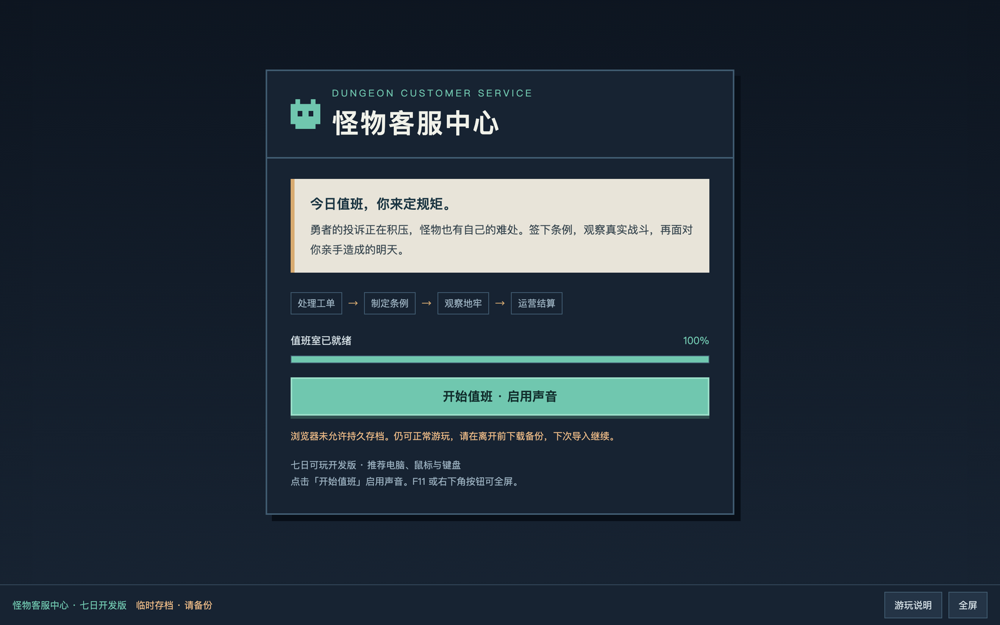

# 怪物客服中心

[浏览器开始值班](https://gongfpp.github.io/monster-service-center-web/)

  

七日试运营开发版。上午处理勇者与怪物的投诉，部署最多八条条例，下午观察真实自动战斗，晚上查看运营日报；当天事故会成为次日投诉。

推荐桌面 Chrome / Firefox、键鼠及横向窗口。数字键 1–4 选择决定，Enter 提交；观战空格暂停，1/2/4 倍速。设置中可下载 JSON 存档备份或导入备份；存档保存于当前浏览器和站点，清除站点数据会删除它。浏览器禁止存储时仍可游玩，请下载备份。macOS 与网页进度各自独立。

此仓库只包含公开网页包及其部署工作流。游戏源码、开发历史和仅用于设计比对的参考图存于独立私有仓库。项目代码、文案与自有素材未在此授予开源复用许可；第三方引擎和字体按 `licenses/` 中的许可使用。网页包提供完整游戏内许可入口。

当前范围为七日、一张六区域地图、23 条规则、40 个工单模板、四条投诉链和四类结局。五名新玩家测试、其他设备实测和完整正式版内容仍待推进，不能视为已经完成。没有遥测、账号或联网存档。

`release.json` 记录来源提交、引擎版本及所有发布文件的 SHA-256；GitHub Actions 校验这些文件后部署。
